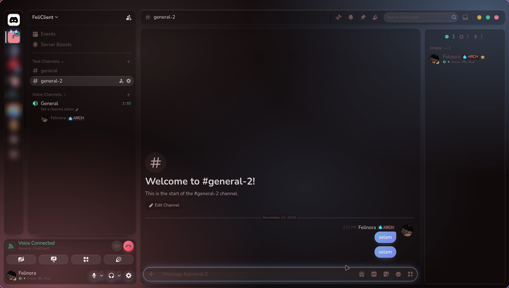
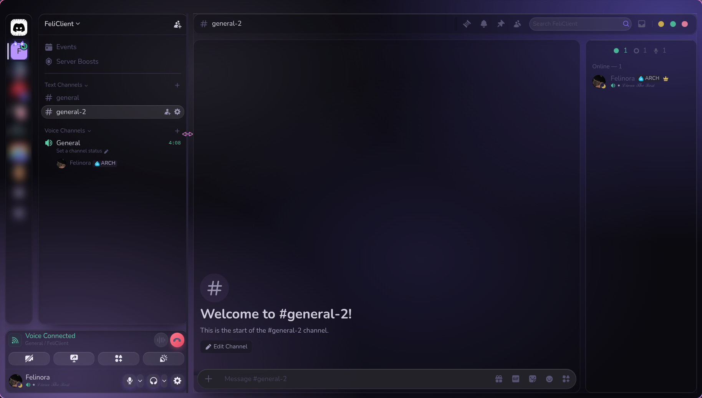

# ฅ^•ﻌ•^ฅ Felinora for Discord

**A liquid glass Discord theme with chat bubbles. Works with [BetterDiscord](https://betterdiscord.app) and [Vencord](https://vencord.dev) / [Vesktop](https://github.com/Vencord/Vesktop).**

*Buzlu cam görünümlü, mesaj baloncuklu bir Discord teması. Türkçe açıklama aşağıda.*

---

## ✨ Features

- **Glass panels** floating over soft colored light (no live blur, so it stays smooth).
- **Chat bubbles.** With the optional [FelinoraBubbles](#-your-messages-on-the-right-optional) plugin, your own messages sit on the right in a gradient bubble.
- **Glass voice controls** and a clear red disconnect button.
- Pill-shaped message box and search, a little pair of cat ears on the selected server, a paw instead of the moon on the DM button.
- **7 color schemes:** Gece Moru (default), Pembe Gece, Obsidyen, Kan Kırmızısı, Buz Mavisi, Sakura, Nane.
- Font: [Nunito](https://fonts.google.com/specimen/Nunito) (loaded from Google Fonts).

## 🚀 Installation

Download [`Felinora.theme.css`](Felinora.theme.css) and put it in your themes folder:

- **BetterDiscord:** Settings → Themes → *Open Themes Folder*, then enable Felinora.
- **Vencord / Vesktop:** Settings → Vencord → Themes → *Open Themes Folder*, then enable Felinora.

### Color schemes

Open the file in a text editor. Near the top there is one active `:root { --fl-… }` line and six commented ones. Delete the active line and remove the `/*` and `*/` around the scheme you want.

## 🐾 Your messages on the right (optional)

Discord doesn't mark which messages are yours, so a pure CSS theme can't move them to the right; without the plugin all bubbles stay on the left. [`vencord-plugin/felinoraBubbles`](vencord-plugin/felinoraBubbles) is a tiny Vencord userplugin that marks your messages. It needs a Vencord built from source: copy the folder into `src/userplugins/`, build, and enable **FelinoraBubbles** ([guide](https://docs.vencord.dev/installing/custom-plugins/)).

---

## 🇹🇷 Türkçe

Paneller renkli ışıkların üstünde buzlu cam gibi durur, mesajlar baloncuk içindedir. **Kurulum:** `Felinora.theme.css` dosyasını BetterDiscord'un ya da Vencord'un tema klasörüne koy ve temayı aç. **Renk şeması:** dosyanın başındaki etkin `:root` satırını sil, istediğin şemanın etrafındaki `/*` ve `*/` işaretlerini kaldır. Kendi mesajlarının sağda görünmesi için isteğe bağlı FelinoraBubbles Vencord eklentisi gerekir.

## 🐾 Also

Same palettes as my Hyprland desktop **[realFelinora/dots](https://github.com/realFelinora/dots)** and Spotify theme **[felinora-spicetify](https://github.com/realFelinora/felinora-spicetify)**.

## Credits

- Built on top of **[Midnight](https://github.com/refact0r/midnight-discord)** by refact0r (MIT), included in the theme file.
- Made by **[realFelinora](https://github.com/realFelinora)**, written with the help of the AI assistant **Claude** (Anthropic).

## License

[MIT](LICENSE)
